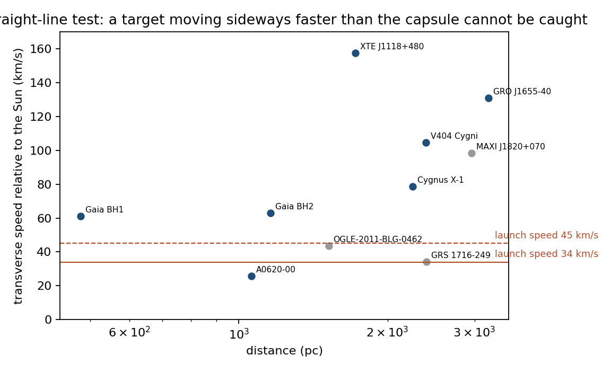
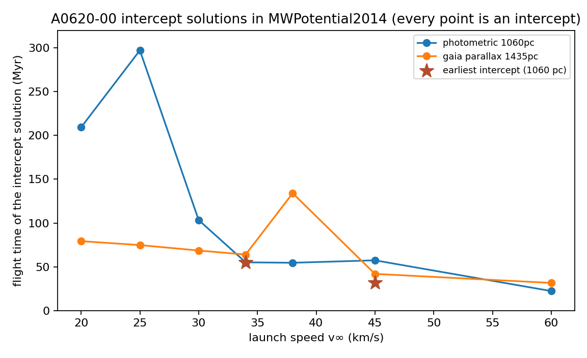

# Interstellar Archive — the proof

Two claims, each reduced to material → data → calculation → number. Every number below is produced by `proof.py` (written to `results.json`); every literature input is listed in `SOURCES.md`. Nothing here is a schema, a validator or a governance artifact.

**Claim 1.** A passive capsule built from materials that have already flown, launched with propulsion that has already been demonstrated in parts, keeps its structure and its data intact through tens of millions of years of interstellar flight.

**Claim 2.** Aimed at the nearest black hole it can physically reach, the capsule has a probability of falling into that black hole that is not zero — and we compute how far from zero it is, with today's astrometry and with the best astrometry physics allows.

Result in one paragraph: the launch is within demonstrated technology classes; the nearest reachable black hole is A0620-00 (V616 Mon, 6.6 M☉, 1.06 kpc), reached in 55 Myr at 34 km/s or 32 Myr at 45 km/s; over that flight the capsule sweeps up about a gram of dust, erodes 0.05–0.3 % of its front shield, sees 5–18 MGy of cosmic rays (below the verified limits of sapphire and fused silica), and faces a probability below 10⁻⁴ of a hit that its Whipple shield cannot stop — provided the standard NASA ballistic-limit equation extrapolates from 10 to 34 km/s, which is the one open experimental question. The probability of capture by A0620-00 is 2 × 10⁻²⁰ with the current catalogue, rising to at most 3 × 10⁻¹⁶ with perfect knowledge of the target's orbit, because stellar encounters scatter the arrival point by ~10⁵ AU against a capture radius of 0.002 AU. Independently of aim, drifting through the disk gives ~10⁻¹⁵ per 100 Myr of falling into *some* black hole. Not zero.

---

## 1. The bullet

| Layer | Material | Thickness | Mass | Role | Has it flown / been tested? |
|---|---|---|---|---|---|
| Front face | C/C-SiC ceramic-matrix composite | 24 mm | 46 kg | erosion face, thermal protection at perihelion | C/C-SiC TPS on SHEFEX I/II, IXV, STORT; Parker Solar Probe's 11.4 cm carbon-composite shield survived 0.046 AU [M8, L3] |
| Bumper | Al-Li alloy | 7 mm | 24 kg | first Whipple wall: vaporises incoming grains | ISS Whipple bumpers are 2 mm Al; 7 mm is heavier than heritage [M3] |
| Stand-off | vacuum gap | 300 mm | 0 | lets the vapour cloud spread before the rear wall | ISS stand-offs are 107–130 mm [M3] |
| Rear wall | B4C/Ta graded plate | 14 mm | 38 kg | stops the debris cloud; neutron/gamma attenuation | ISS rear walls are 4.8 mm Al; this is a dense, thick substitute |
| Vault | Ti-6Al-4V | 12 mm | 52 kg | rigid enclosure for the media | standard aerospace alloy |
| Media | fused-silica platters + etched sapphire/nickel plates | — | 28 kg | dense digital payload + human-readable bootstrap | Project Silica: 4.8 TB per 120 mm × 2 mm platter, read with 445–525 nm light [M7]; Rosetta-disk-style etched plates |
| Reserve | duplicate media, fixtures | — | 18 kg | redundancy | — |

Total 206 kg, 1.52 m diameter, frontal area 1.81 m² — the mass and shape of the Genesis sample-return capsule (205.6 kg, 1.5 m, [L4]). Front shield areal density 60 kg/m². Nothing moves, nothing is powered after the early phase, nothing is warmer than the interstellar radiation field.

## 2. The launch

Earth → Jupiter gravity assist → fall to a perihelion of 0.05–0.10 AU → solid-motor burn of 2–3 km/s at perihelion → ballistic forever. The asymptotic speed follows from vis-viva (`proof.py`, section A):

| Perihelion | Burn | v∞ |
|---|---|---|
| 0.10 AU (21.5 R☉) | 2 km/s | 23.2 km/s |
| 0.10 AU | 3 km/s | 28.4 km/s |
| 0.05 AU (10.8 R☉) | 2 km/s | 27.5 km/s |
| 0.05 AU | 3 km/s | **33.8 km/s** |
| 0.05 AU, with 30 km/s inbound excess | 3 km/s | 45.3 km/s (conditional) |

The NASA NIAC scaling law V = 7.4 ΔV^½ r_p^−¼ gives the same 23–34 km/s band [L1]; NASA's interstellar-probe studies use exactly this regime (11 R☉, 2.5–3.5 km/s kick stage) [L2]. Solar flux at 0.05 AU is 0.54 MW/m²; Parker Solar Probe flew at 0.65 MW/m² (9.86 R☉) behind an 11.4 cm carbon-composite shield [L3]. What has not been done is firing a solid motor through that shield at perihelion — an integration test, not a physics question.

We use 34 km/s as the baseline and 45 km/s as the conditional upper case.

## 3. Where to aim

A capsule at 34 km/s cannot catch a target that moves sideways faster than 34 km/s: in straight-line kinematics the speed needed to meet a target at distance D receding at v_r with transverse speed v_t is √((D/t + v_r)² + v_t²) ≥ v_t for any flight time. The nearest known black holes, with their heliocentric motion from Gaia and the X-ray-binary literature [T1–T6]:

| Black hole | Distance | Transverse speed | Radial velocity | Straight-line intercept at 34 / 45 km/s |
|---|---|---|---|---|
| Gaia BH1 | 478 pc | 61 km/s | +23 | impossible / impossible |
| Gaia BH3 | 594 pc | 444 km/s | −333 | impossible (halo object) |
| **A0620-00** | 1060 pc | **26 km/s** | +8.5 | **77 Myr / 37 Myr** |
| Gaia BH2 | 1160 pc | 63 km/s | −5 | impossible |
| OGLE-2011-BLG-0462 | 1520 pc | 44 km/s | unknown (isolated) | impossible / undetermined |
| XTE J1118+480 | 1720 pc | 157 km/s | +3 | impossible |
| Cygnus X-1 | 2250 pc | 79 km/s | −5 | impossible |
| V404 Cygni | 2390 pc | 105 km/s | 0 | impossible |
| GRS 1716-249 | 2400 pc | 34 km/s | unknown | impossible / undetermined |
| MAXI J1820+070 | 2960 pc | 98 km/s | unknown | impossible |
| GRO J1655-40 | 3200 pc | 131 km/s | −142 | impossible |



Straight lines are not the whole story: over tens of millions of years both the Sun and the target orbit the Galaxy, and relative motion in the disk is epicyclic with a period 2π/κ ≈ 170 Myr [G3]. So `proof.py` integrates the target and the capsule in the Milky Way potential (galpy `MWPotential2014`, [G1]) and searches the whole sky of launch directions for the one that minimises the closest approach within 300 Myr:

| Black hole | 34 km/s | 45 km/s |
|---|---|---|
| Gaia BH1 | closest 470 pc — unreachable | 442 pc — unreachable |
| Gaia BH3 | unreachable | unreachable |
| **A0620-00** | **intercept at 55.1 Myr** (aim l = 231.8°, b = −43.0°; the target is now at l = 210°, b = −6.5°) | **intercept at 31.6 Myr** (aim l = 228.4°, b = −13.4°) |
| Gaia BH2 | unreachable | intercept at 207 Myr |
| V404 Cygni | intercept at 166 Myr | intercept at 177 Myr |
| Cygnus X-1 | intercept at 271 Myr | intercept at 153 Myr |
| XTE J1118+480 | marginal at 296 Myr | 299 Myr |
| GRO J1655-40 | unreachable | unreachable |

The intercept solutions beyond ~100 Myr exist only in a smooth, axisymmetric potential; the real disk (spiral arms, molecular clouds) scatters orbits by kilometres per second on that time-scale, so they are not usable targets. The one solution inside the predictable horizon is **A0620-00: 55 Myr at 34 km/s, 32 Myr at 45 km/s.** If the Gaia parallax distance (1.43 kpc) is right instead of the photometric 1.06 kpc, the times become 64 and 42 Myr. Any launch speed above 12 km/s reaches A0620-00 within 80 Myr in the smooth potential, and Gaia BH1 would need 50 km/s and 262 Myr — outside any predictable horizon.



The lead angle is large — 40° from the target's present position at 34 km/s — because the capsule flies a curved path of 1.9 kpc to meet a target that will have moved 1.5 kpc. That distance, not the present 1.06 kpc, is what the capsule must survive.

## 4. Why it survives

Computed for the A0620-00 flight at 34 km/s (path 1916 pc, 55.1 Myr) and, for comparison, for a generic 480 pc / 13.8 Myr crossing at the same speed (`proof.py`, section C).

### 4.1 Fine dust: erosion

Interstellar dust density measured in situ by Ulysses: (2.1 ± 0.6) × 10⁻²⁴ kg/m³ with gas-to-dust 193 [D1]. The sightline to A0620-00 has E(B−V) = 0.30 [T4], which through N_H = 5.8 × 10²¹ E(B−V) cm⁻² [D4] gives a mean hydrogen density of 0.53 cm⁻³ — three times the Local Cloud value of 0.17 cm⁻³ — and a dust column of 1.3 g over the whole path at gas-to-dust 100.

| | 480 pc / 13.8 Myr | A0620-00 / 55 Myr |
|---|---|---|
| Dust swept (Local-Cloud density) | 0.056 g | 0.22 g |
| Dust swept (sightline density from reddening) | — | 1.33 g |
| Kinetic energy of all that dust at 34 km/s | 33 kJ | 130–770 kJ |
| Eroded shield mass at 100× cratering efficiency | 5.6 g (0.012 % of the 46 kg face) | 22–133 g (0.05–0.29 %) |

Sub-micron grains hit the shield 10¹²–10¹³ times over the flight, each leaving a micro-crater; summed, the entire dust load of 55 Myr carries a few hundred kilojoules — one rifle bullet's worth of energy, spread over more impacts than any spacecraft has ever seen — and removes less than a third of a percent of the face. Erosion is not the problem.

### 4.2 Large grains: the only thing that can kill the capsule

The risk is a single grain heavy enough to breach the shield. What is known about interstellar grains larger than in-situ detectors see (≤ ~10⁻¹³ kg, a few µm [D2]) comes from meteor surveys at Earth, which bound the number density of interstellar meteoroids. Converting each flux at Earth to a density (n = F / 26 km/s, gravitational focusing ignored, which is conservative) and multiplying by frontal area and path:

| Population | Constraint [D3] | Expected hits, 480 pc | Expected hits, A0620-00 | Energy per hit at 34 km/s |
|---|---|---|---|---|
| m > 2 × 10⁻⁷ kg (~0.5 mm) | optical upper limit, Musci et al. 2012 | < 57 | < 229 | 0.1 kJ |
| m > 1.8 × 10⁻⁷ kg (~0.5 mm) | 5 radar candidates in 11 million orbits, Froncisz et al. 2020 | 0.19 | 0.75 | 0.1 kJ |
| m > 6.6 × 10⁻⁵ kg (3.4–5 mm) | 95 % upper limit, Wiegert et al. 2025 | < 2.3 × 10⁻⁵ | < 9.1 × 10⁻⁵ | 38 kJ (9 g TNT) |

So: sub-millimetre hits are expected (of order one over the A0620-00 flight, if the radar candidates are real); millimetre-class hits are rare; anything above ~5 mm has probability below 10⁻⁴.

What the shield stops. The NASA "new non-optimum" Whipple ballistic limit for the hypervelocity regime [M1],

d_c = 3.918 · t_w^(2/3) · ρ_p^(−1/3) · ρ_b^(−1/9) · V^(−2/3) · S^(1/3) · (σ/70)^(1/3),

with a 14 mm rear wall, 2.65 g/cm³ bumper, 30 cm stand-off and Al-2219 strength, gives a critical projectile diameter of **8.7 mm at 34 km/s** (7.3 mm at 45 km/s) for 3.3 g/cm³ grains — a critical mass of 1.16 g (0.66 g at 45 km/s). Everything in the table above is below that mass by a factor of at least 17. The equation's caveat: it is validated to ~10 km/s; in the 6.9–9.9 km/s tests of Piekutowski et al. 2011 the shields did *better* than it predicts as velocity rose. No facility can fire a millimetre grain at 34 km/s (light-gas guns stop near 10 km/s; Van de Graaff accelerators reach 90 km/s only for picogram grains [M2]), so the 34 km/s performance rests on the equation, on hydrocodes, and on the physics that a faster impact vaporises the projectile more completely.

Survival probability against impacts, then:
- if the shield performs as the equation says (stops < 8.7 mm): P(fatal hit) < 9 × 10⁻⁵ over the A0620-00 flight, < 2.3 × 10⁻⁵ over 480 pc;
- if the shield stopped nothing above 0.5 mm (the equation wrong by a factor 17 in diameter): P(fatal hit) = 1 − e^(−0.75) = 53 % over A0620-00, 17 % over 480 pc — with the 0.75 itself resting on five unconfirmed radar candidates.

### 4.3 Radiation

Galactic cosmic rays: 0.167 Gy/yr absorbed dose measured in interplanetary cruise (MSL/RAD, ~16 g/cm² shielding) [M4]. Outside the heliopause the low-energy peak is 15× higher but the dose-carrying GeV part changes little; we take a factor 1–2:

| | 480 pc / 13.8 Myr | A0620-00 / 55 Myr |
|---|---|---|
| Dose | 2.3–4.6 MGy | 9–18 MGy |
| Fused silica, visible transmission verified intact to | 18 MGy (LHC irradiation, [M5]) | same |
| Sapphire, radiation-hard to | 100 MGy [M6] | same |
| Silica compaction begins above | ~1 GGy [M5] | same |

The etched sapphire/nickel bootstrap plates are untouched at these doses. The fused-silica payload is at the top of its verified range for the 55 Myr flight and well inside it for 14 Myr; readout is at 445–525 nm, the least affected part of the spectrum (damage concentrates at 240 nm). The MSL figure was measured behind ~16 g/cm² of surrounding material, comparable to the vault's own walls, so it is representative rather than conservative.

### 4.4 Gas, drag, temperature

A hydrogen atom hits the front face at 6 eV (10.6 eV at 45 km/s); the sputtering threshold of graphite is 40–50 eV [D6] — no chemical erosion by the gas. The swept gas (43 g over the A0620-00 path) decelerates the 206 kg capsule by 7 m/s in total — irrelevant for survival, and along-track so irrelevant for aim. Equilibrium temperature in the interstellar radiation field is ~10 K; nothing in the stack has a phase change, a seal, a lubricant or a battery.

### 4.5 Verdict on Claim 1

| Threat | Number | Kills the capsule? |
|---|---|---|
| Erosion by fine dust | ≤ 0.3 % of the face | no |
| Sub-mm grains | ~1 hit, 0.1 kJ each, 1000× below the shield limit | no |
| > 5 mm grains | P < 10⁻⁴ | the only real risk |
| Cosmic rays | 9–18 MGy vs. 18 MGy (silica) / 100 MGy (sapphire) verified | no |
| Gas | 6 eV vs. 40 eV threshold | no |

P(structure and data intact after 55 Myr) = **0.9999 if the Whipple equation holds at 34 km/s; 0.47 if it fails completely**; the equation and the highest-velocity data both point to the upper end. Over a 10–14 Myr / 480 pc flight the same numbers are 0.99998 and 0.83. Claim 1 is established up to one experimental question: the behaviour of a stand-off shield against millimetre grains at 30–45 km/s.

## 5. The probability of falling in

`proof.py`, section D, for A0620-00 (6.6 M☉).

**Capture radius.** A slow particle is captured by a Schwarzschild black hole if its impact parameter is below b = 4GM/(c v∞) [P1]. At the 36 km/s relative speed of the encounter: b = 321,000 km = **0.0021 AU** (the Schwarzschild radius is 19.5 km; gravity focuses the capture cross-section 16,000× in radius). At 45 km/s: 0.0017 AU.

**Where the target will be.** The capsule is aimed at where A0620-00 will be in 55 Myr. Propagating the catalogue uncertainties (distance ± 100 pc, proper motion ± 0.1 mas/yr, systemic velocity ± 1.8 km/s) gives a transverse scatter of the target's future position of 16 × 6 million AU — 80 by 30 parsecs. Even if every catalogue error shrank a hundredfold, unknowable perturbations remain: passing field stars (19.7 within 1 pc per Myr [G6]) kick both the capsule and the target by metres per second; a Monte Carlo of those kicks scatters the relative arrival point by **9.5 × 10⁴ AU** per axis over 55 Myr (4.2 × 10⁴ AU over 32 Myr). Molecular clouds and spiral arms, not modelled here, can only add to this. A course correction of 1 m/s in the first years can move the arrival point by 11,600 AU — enough to cancel a well-measured error, useless against the unmeasurable ones.

**P(capture) = b² / (2 σ_x σ_y)** for a Gaussian arrival scatter:

| Knowledge of the target | Arrival scatter (per axis) | P(capture) 34 km/s | P(capture) 45 km/s | P(pass within 1000 AU) |
|---|---|---|---|---|
| Today's catalogue | 1.6 × 10⁷ × 6.3 × 10⁶ AU | **2.3 × 10⁻²⁰** | 5.6 × 10⁻²⁰ | 5 × 10⁻⁹ |
| Errors 10× smaller (Gaia end-of-mission class) | 1.6 × 10⁶ × 6.3 × 10⁵ AU | 2.2 × 10⁻¹⁸ | 5.6 × 10⁻¹⁸ | 5 × 10⁻⁷ |
| Errors 100× smaller | 1.9 × 10⁵ × 1.1 × 10⁵ AU | 1.1 × 10⁻¹⁶ | 3.2 × 10⁻¹⁶ | 2 × 10⁻⁵ |
| Perfect astrometry, stellar encounters only (physical floor) | 9.5 × 10⁴ AU | **2.5 × 10⁻¹⁶** | 8.7 × 10⁻¹⁶ | 5 × 10⁻⁵ (3 × 10⁻⁴ at 45 km/s) |

**Without aiming.** The Galaxy holds ~1.2 × 10⁸ single black holes of mean mass 14 M☉ [G8]; near the Sun that is 1–5 × 10⁻⁴ per pc³. A capsule crossing the disk at 40 km/s relative to them is captured at a rate n σ v = **0.5–2.6 × 10⁻¹⁷ per Myr**: 3–14 × 10⁻¹⁶ over the 55 Myr flight, 0.5–2.6 × 10⁻¹⁵ per 100 Myr of drift, up to ~10⁻¹⁴ over the 300–600 Myr for which the sapphire plates stay inside their verified 100 MGy (the shield itself, if it performs as modelled, would last far longer: fewer than 2 × 10⁻⁶ fatal hits per Myr). For scale, the capsule is 270,000 times more likely to fall into an ordinary star (1.4 × 10⁻¹² per Myr, gravitational focusing included) than into a black hole.

### Verdict on Claim 2

Aimed at the nearest reachable black hole, the capsule's probability of capture is **2 × 10⁻²⁰ today, and cannot exceed ~3 × 10⁻¹⁶ with any astrometry**, because the arrival point is scattered by stellar encounters over ~10⁵ AU while the capture radius is 0.002 AU. Independently of aim, ~10⁻¹⁵ per 100 Myr. The whitepaper's "Case B" — a pass within 1000 AU — has probability 5 × 10⁻⁹ today and 5 × 10⁻⁵ at best. All of these are computed from measured quantities and standard physics, and none of them is zero.

## 6. Summary

| Statement | Number | What sets it | `results.json` key |
|---|---|---|---|
| Escape speed from a 0.05 AU / 3 km/s Sun-Oberth | 33.8 km/s | vis-viva; NIAC scaling agrees | `A.vinf_q0.05au_dv3000` |
| Nearest reachable black hole | A0620-00, 6.6 M☉, 1.06 kpc | heliocentric transverse speed 26 km/s < 34 km/s | `B.straight_line_table` |
| Flight time to intercept | 55 Myr (34 km/s), 32 Myr (45 km/s) | orbit integration in MWPotential2014 | `B.galpy.A0620_earliest` |
| Gaia BH1 (the nearest black hole) | unreachable below 50 km/s | transverse speed 61 km/s | `B.galpy.min_vinf` |
| Dust swept over the A0620-00 path | 0.2–1.3 g | Ulysses density; sightline reddening | `C_A0620_34kms.swept_dust_mass_*` |
| Front-face erosion | 0.05–0.3 % | 100× cratering efficiency | `C_A0620_34kms.eroded_shield_fraction_*` |
| Expected sub-mm hits | 0.75 | CMOR interstellar candidates | `C_A0620_34kms.expected_hits_m>1.8e-07kg_(0.5mm)` |
| Expected hits above 66 mg (> 5 mm) | < 9 × 10⁻⁵ | Wiegert et al. 2025 upper limit | `C_A0620_34kms.expected_hits_m>6.6e-05kg_(3.4mm)` |
| Shield critical diameter at 34 km/s | 8.7 mm (1.16 g) | NASA NNO ballistic limit, extrapolated | `C_A0620_34kms.whipple_critical_diameter_rho3.3` |
| Cosmic-ray dose, 55 Myr | 9–18 MGy | MSL/RAD cruise rate × 1–2 | `C_A0620_34kms.gcr_dose_lism_factor_*` |
| P(survive 55 Myr) | 0.9999 (shield as modelled) … 0.47 (shield fails) | large-grain flux × shield limit | derived from the two rows above |
| Capture impact parameter | 0.0021 AU | b = 4GM/(c v) | `D_A0620_34kms.capture_impact_parameter_b_au` |
| Arrival scatter, today | 1.6 × 10⁷ AU | catalogue distance and proper-motion errors | `D_A0620_34kms.today_catalog_errors_sigma_axes` |
| Arrival scatter, physical floor | 9.5 × 10⁴ AU | stellar-encounter Monte Carlo | `D_A0620_34kms.encounter_dispersion_per_axis` |
| P(capture by A0620-00) | 2.3 × 10⁻²⁰ today, ≤ 2.5 × 10⁻¹⁶ ever | the two rows above | `D_A0620_34kms.*_P_capture` |
| P(capture by any black hole) | 0.5–2.6 × 10⁻¹⁵ per 100 Myr | BH density × capture cross-section × speed | `D_population.expected_captures_100Myr_*` |
| P(falling into a star), per Myr | 1.4 × 10⁻¹² | stellar density × focused cross-section | `D_population.star_collision_rate_per_Myr` |

## 7. What would sharpen this

1. A hydrocode (or reviewed analytic) treatment of a 7 mm Al-Li bumper / 30 cm stand-off / 14 mm dense wall against 1–10 mm silicate grains at 30–45 km/s. This is the single assumption the survival number depends on.
2. Gaia DR4/DR5 astrometry of A0620-00 (and a resolution of its 1.06 vs 1.43 kpc distance). This moves P(capture) from 10⁻²⁰ toward the 10⁻¹⁶ floor and P(1000 AU pass) toward 10⁻⁵; nothing moves either above that.
3. A perturbed-potential integration (spiral arms, molecular clouds) to put a number on the arrival scatter that the smooth-potential calculation leaves out. It can only lower the probabilities.

## Reproduce

```bash
pip install numpy scipy astropy galpy matplotlib
python3 proof.py --figures      # ~15 min the first time (orbit search), seconds afterwards (cached in galpy_cache.json)
```

`targets.json` holds the black-hole catalogue with per-object sources; `SOURCES.md` lists every literature value with the page it was read from; `results.json` holds every number in this document.
